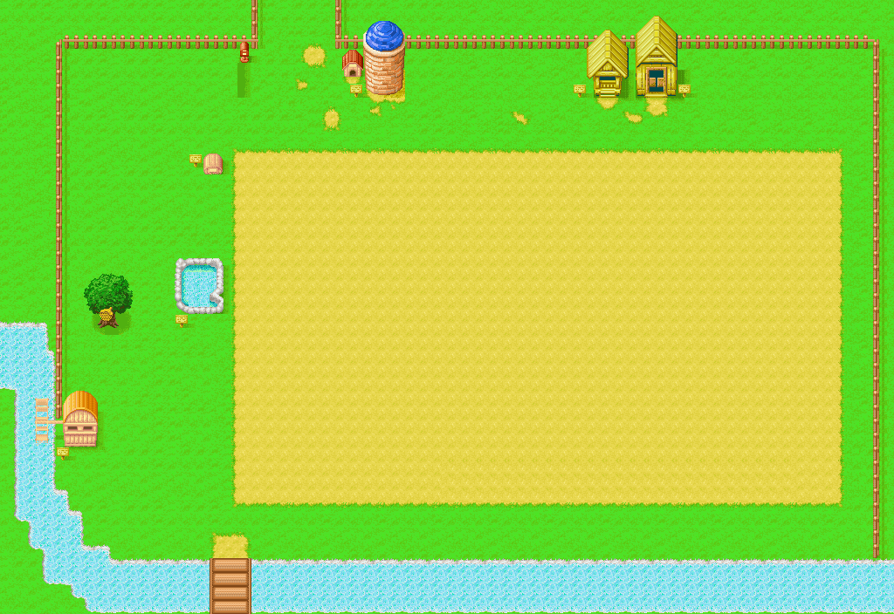
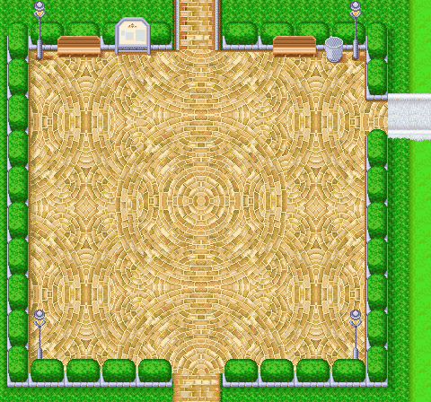
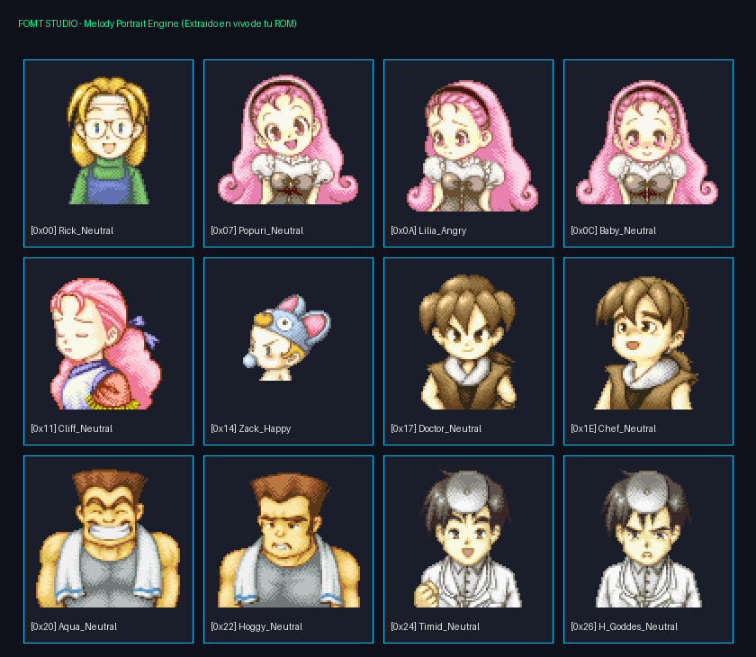
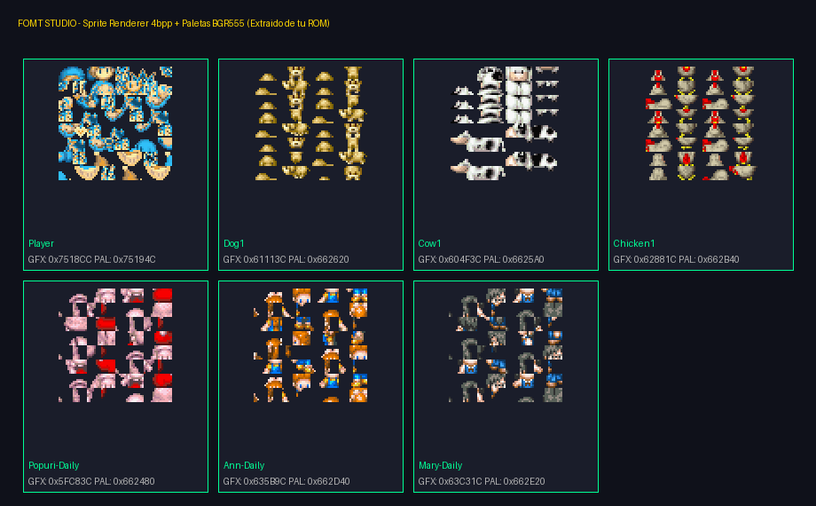
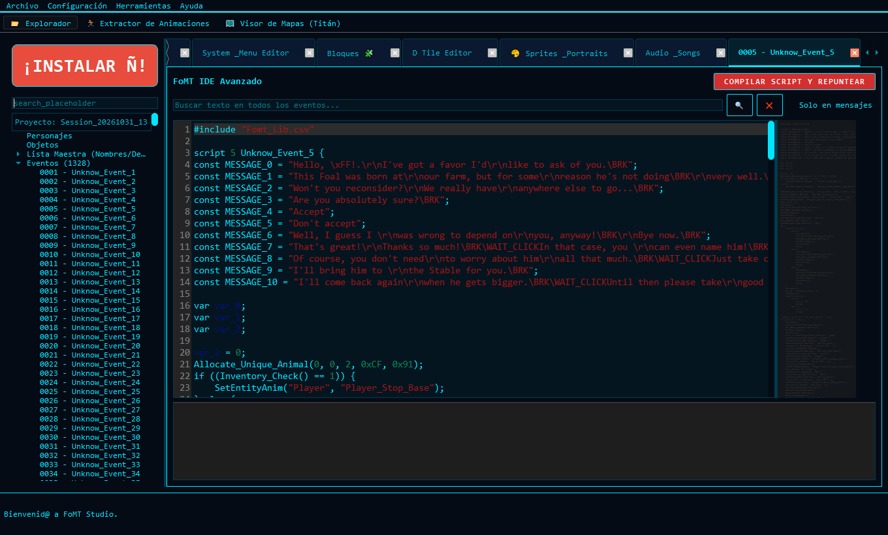
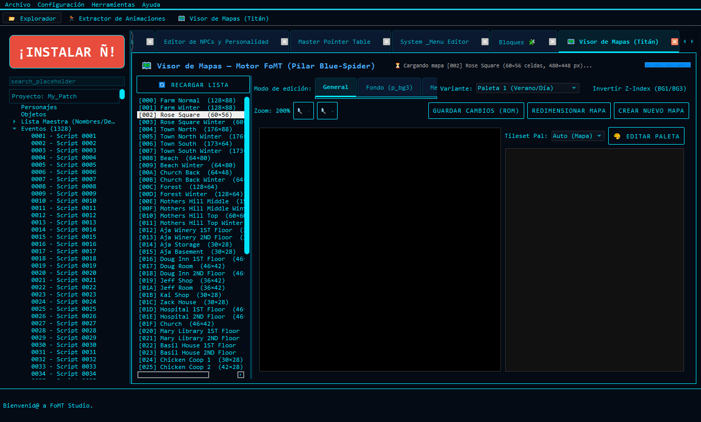
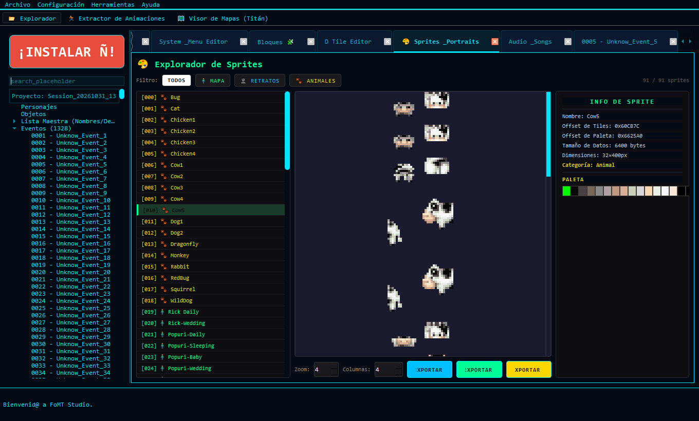
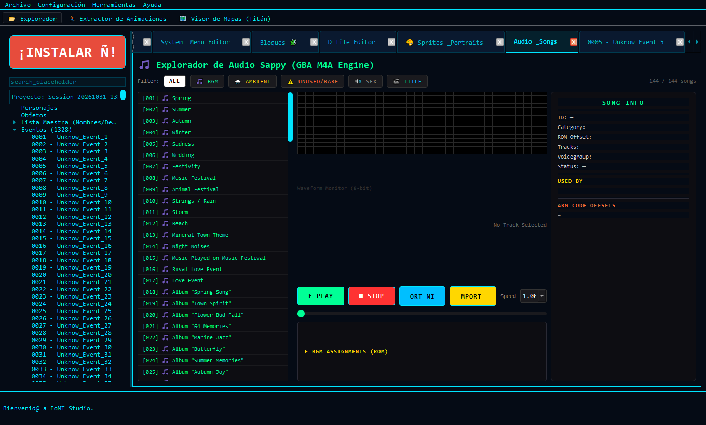
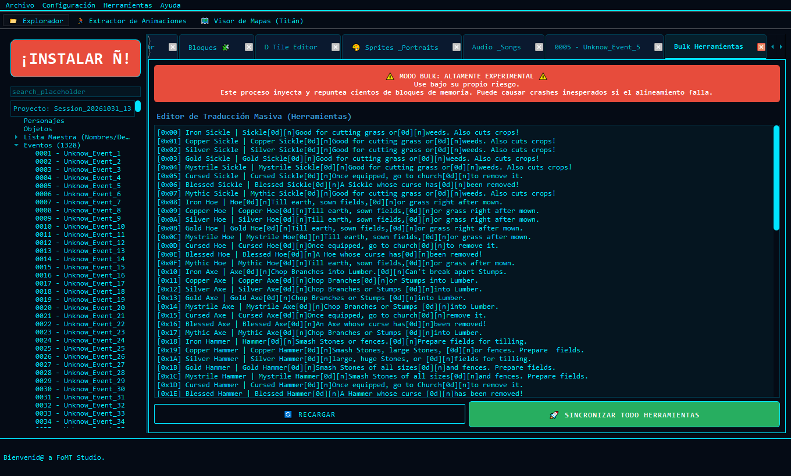
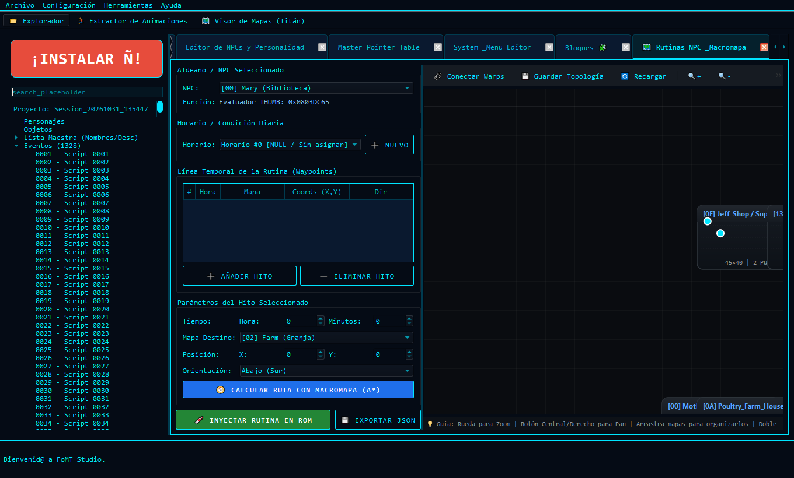

# Harvest Moon: Friends of Mineral Town (GBA) — Ecosistema de Decompilación, Ingeniería Inversa y ROM Hacking

Este repositorio unifica los proyectos clave de decompilación, análisis de bytecode y herramientas gráficas de modificación para **Harvest Moon: Friends of Mineral Town (USA)** de Game Boy Advance (`HARVESTMOGBAA4NE`), **excluyendo cualquier archivo ROM propietario (`.gba`)**.

> **¿Eres principiante? Lee la [Guía para principiantes](./GUIA_PRINCIPIANTES.md).**

---

## FoMT Suite (HTML, sin instalar nada)

Abre **[`FoMT_Suite.html`](./FoMT_Suite.html)** con doble clic (Chrome, Edge o Firefox). Abres la ROM **una sola vez** y todas las herramientas la usan; cuando una inyecta cambios, esa ROM pasa a ser la «ROM de trabajo» y puedes seguir con las demás o descargarla.

| Herramienta | Archivo | Qué hace |
| :--- | :--- | :--- |
| **Mapas** | [`herramientas/mapas.html`](./herramientas/mapas.html) | Capas 0–2 y **capa 3 de edificios/muebles** (los parches que el juego pega según lo comprado), colisión, **warps con su destino real**, bloques 16×16 de 3 capas al estilo Advance Map, piezas (capturar por capas, edificios, PNG importados), tiles nuevos, **mapas nuevos**, exportar PNG e inyectar en la ROM (ampliada a 32 MB). |
| **Textos, NPC y retratos** | [`herramientas/textos_npc.html`](./herramientas/textos_npc.html) | Traducción de diálogos, eventos nuevos, hablantes, retratos e importación de retratos desde imágenes; genera ROM e IPS. |
| **Sprites** | [`herramientas/sprites.html`](./herramientas/sprites.html) | **Sprites de NPC animados en sus 4 poses** (abajo, arriba, izquierda, derecha) y **retratos**, leídos de la ROM real. Exportar e **importar hojas PNG** (con la paleta actual o una sacada del PNG), **NPC nuevos** y **retratos nuevos** a partir de una plantilla; verifica la ROM generada releyéndola desde los punteros del juego. |
| **Audio** | [`herramientas/audio.html`](./herramientas/audio.html) | Música y efectos de **FoMT (motor m4a/Sappy de GBA)** y de Harvest Moon DS (SDAT): reproducir, silenciar/solo por pista, velocidad, transposición, exportar WAV y MIDI, escuchar las muestras. **Importar MIDI** a la ROM de GBA (canción o efecto nuevo, o reemplazar uno existente) con un voicegroup existente o uno nuevo con muestras WAV. |

Cada herramienta también funciona sola. Se comunican con la suite por `postMessage` a través de [`herramientas/fomt-hub.js`](./herramientas/fomt-hub.js), así que no hace falta servidor ni compilar nada. Para añadir una herramienta nueva: crea su HTML en `herramientas/`, incluye `fomt-hub.js`, llama a `FomtHub.onRom(...)` para recibir la ROM y a `FomtHub.publish(...)` tras inyectar, y añádela a `TOOLS` en `FoMT_Suite.html`.

### Datos de la ROM que usan las herramientas

| Dato | Offset (USA) | Notas |
| :--- | :--- | :--- |
| Tabla de mapas | `0x105EDC` | 66 entradas de 40 bytes; única referencia en el literal `0x0A46A8` (`GetMapData`), por eso se puede reubicar para añadir mapas. |
| Tabla de parches (edificios y muebles) | `0x10692C` | 82 entradas de 24 bytes (ancho, alto, 3 capas u16 sin comprimir, tipos y rejilla de colisión). El mapa de cada parche sale de la tabla de saltos por mapa en `0x080A685C`. |
| Colisión → scripts | — | Campo «evento» = nº de script (salidas); campo «objeto» ÷ 2 = nº de script (puertas). El destino es el `Warp_Player(escena, x, y)` de ese script. |
| Tabla de canciones m4a | `0x13ABF0` | 211 entradas de 8 bytes {canción, reproductor, reproductor} (`gSongTable` en la decomp de StanHash). Reproductor 0 = música, 3 = efectos; hay 5 reproductores de 8 pistas (`gMusicPlayerTable`, `0x13ABB4`). La apuntan 11 literales: `0x8B84`, `0x8BAC`, `0x8BCC`, `0x8D58`, `0x8D6C`, `0x8D80` (`asm/hardware.s`) y `0xD2300`, `0xD2334`, `0xD2380`, `0xD23D4`, `0xD2408` (`m4aSongNum*` en `src/m4a.c`). Al añadir canciones se copia ampliada al espacio libre y se repuntan los 11; el audio la relee desde `0xD2300`. |
| Banco de sprites | `0x58BA28` (`gUnk_0858BA28`) | 7 secciones seguidas, cada una `u16 cantidad, u16 0` + entradas (lo lee `func_0805E6CC`): animaciones (2551 × 4 B: nº de pasos, primer paso), fotogramas (3009 × 16 B: nº/1er OAM, nº/1er tile, nº/1ª paleta, nº/1º extra), OAM (4795 × 8 B, attr0–2 de GBA), tiles 4bpp (24398 × 32 B), paletas (162 × 32 B), extra (0) y pasos (3990 × 4 B: fotograma, duración en frames). Lo apuntan 29 literales del código (`0xCC8`, `0x52714`, …, `0xC11D8`, lista en `sprites.html`). |
| Banco de retratos | `0x52D984` (`gUnk_0852D984`) | Mismo formato; 184 animaciones = 184 IDs de retrato. Lo apuntan 3 literales: `0xADC7C`, `0xADD00`, `0xADD3C`. |
| Dirección de un NPC | — | `AActorEntity::RefreshSprite(anim_id + facing)` (`StanHash_fomt/src/entity_actor.cc`): un NPC son 4 animaciones seguidas, base + 0 abajo, + 1 arriba, + 2 izquierda, + 3 derecha (derecha suele reutilizar los tiles de izquierda con OAM espejados). |

### Importar MIDI (audio, GBA)
**Importar MIDI a la ROM…** (columna derecha de `audio.html`, con una ROM de GBA abierta):
- **MIDI → m4a/MP2K**: una pista por canal MIDI (máx. 8, lo que admite cada reproductor), 24 ticks por negra. Convierte tempo, programa, volumen (CC7 × CC11), panorama, pitch bend y su rango (RPN 0), modulación, notas `N1`–`N96` (+ gate) y `TIE`/`EOT` para las más largas. Puedes cambiar el programa de cada canal; el canal 10 va a la batería del voicegroup.
- **Bucle**: marcadores `[` y `]` (o `loopStart`/`loopEnd`, o CC111), la canción entera o sin bucle (efectos). Termina con `GOTO` al punto de bucle y vuelve a emitir el estado allí.
- **Voicegroup**: uno de la ROM o uno nuevo (copia del elegido) con muestras **WAV** en los programas que elijas, guardadas como WaveData de 8 bits (cabecera de 16 bytes, frecuencia ajustada a la nota raíz, bucle y nota raíz del chunk `smpl` si lo tiene).
- **Destino**: reemplazar una canción o efecto (solo cambia su entrada de `gSongTable`) o añadir uno nuevo (copia `gSongTable` ampliada y repunta sus 11 referencias). Todo se escribe tras el último byte que no es `0x00`/`0xFF`, la cabecera va al final (acaba en un puntero) y, si no cabe, la ROM se amplía a 16 o 32 MB.
- Al terminar relee la ROM generada, reproduce la canción y la envía a la suite con `FomtHub.publish`; también se puede descargar.

### Sprites y retratos (`sprites.html`)
- **Visor**: la lista agrupa las animaciones consecutivas con la misma paleta («personajes»; los nombres son aproximados, del catálogo de FOMT_Studio). Los grupos de 4 direcciones se detectan en la ROM (la pose 3 reutiliza los tiles de la 2 con otro OAM) y se reproducen en bucle con sus duraciones reales.
- **Hoja PNG**: una fila por animación, una columna por fotograma que no salió antes, celdas del tamaño del personaje. Al importar, cada píxel vuelve al tile que lo dibuja; con «paleta del PNG» se calculan hasta 15 colores y se avisa si otras animaciones comparten esa paleta.
- **NPC / retratos nuevos**: copia el personaje plantilla (animaciones, pasos, fotogramas, tiles y paleta propios; los OAM se comparten) al final de su banco, escribe el banco ampliado en el espacio libre (tras el último `0xFF` final; se amplía la ROM por MB si no cabe; termina con la marca `FMSP`) y repunta sus literales. El NPC nuevo tiene su anim base (+0…+3 = direcciones); el retrato nuevo, su ID = nº de animación.
- **Generar ROM**: relee la ROM desde los punteros del código y compara cada animación (fotograma a fotograma, píxel y color) con la ROM de partida o con lo importado; si algo difiere no deja descargar. `textos_npc.html` localiza el banco de retratos por su puntero, así que ve los retratos nuevos.

### Pendiente
- Editar el destino de un warp (requiere recompilar el script) y que una escena cargue un mapa nuevo.
- NPC: que el juego coloque y mueva un NPC nuevo (tabla de NPC, horarios y scripts que usen su anim base) y que los diálogos usen los IDs de retrato nuevos; rutas en el editor de mapas.
- Audio: que el juego llame a las canciones nuevas (#211 en adelante) desde sus scripts; hoy suenan en el juego las que reemplazan a una existente.

---

## Estructura del Repositorio y Genealogía Técnica

| Carpeta | Proyecto Base | Lenguaje | Propósito dentro del Ecosistema |
| :--- | :--- | :--- | :--- |
| **[`StanHash_fomt/`](./StanHash_fomt)** | [StanHash/fomt](https://github.com/StanHash/fomt) | C++ (`agbcp`) / C (`agbcc`) / ASM | **Decompilación 1:1 (*matching*)**: Recompila una ROM 100% idéntica byte por byte (`SHA1: a2fc3574f0a65a4fcf7682fb274b9d7eebdef963`) a partir de las clases originales en C++ (`Farmer`, `Bachelorette`, `Field`, `Barn`, `Coop`, `Animal`, `ScriptEngine`). |
| **[`StanHash_mary/`](./StanHash_mary)** | [StanHash/mary](https://github.com/StanHash/mary) | Rust | **Compilador y Descompilador de Scripts original**: Primer motor capaz de traducir el bytecode de eventos de la máquina virtual de pila (`0x0F89D4`) a código estructurado de alto nivel (`if/else`, `switch`, `do/while`) usando la librería [`lib_fomt.txt`](./StanHash_mary/goodies/lib_fomt.txt). |
| **[`HM-Studio/`](./HM-Studio)** | [andrey-moura/HM-Studio](https://github.com/andrey-moura/HM-Studio) | C++ (`wxWidgets`) | **Precursor de edición GUI**: Primer entorno visual para editar ítems, cartas, fuentes, guardados y descomprimir gráficos de FoMT/MFoMT. |
| **[`FIO-DECOMP-HMFOMT/`](./FIO-DECOMP-HMFOMT)** | [Denisovich728/FIO-DECOMP-HMFOMT](https://github.com/Denisovich728/FIO-DECOMP-HMFOMT) | Pseudo-C (Ghidra) / JSON / Markdown | **Base de Datos de Referencia y Documentación**: Contiene **30,001 cadenas de texto** ([`strings.h`](./FIO-DECOMP-HMFOMT/include/text/strings.h)), los **1,328 eventos descompilados** ([`assets/events/`](./FIO-DECOMP-HMFOMT/assets/events)), catálogos JSON de retratos/sprites/animaciones y documentación arquitectónica en [`docs/`](./FIO-DECOMP-HMFOMT/docs). |
| **[`FOMT_Studio/`](./FOMT_Studio)** | [Denisovich728/FOMT_Studio](https://github.com/Denisovich728/FOMT_Studio) | Python 3 (`PyQt6`) | **Suite Todo-en-Uno de Ingeniería Inversa y Modding (v3.7.1)**: Integra y expande los hallazgos de `mary`, `HM-Studio`, `StanHash/fomt` y `u/MelodyCrystel` en una interfaz gráfica completa. |

---

## Arquitectura de `FOMT_Studio` (v3.7.1 "Listen The World")

`FOMT_Studio` recoge las bases de `StanHash/mary`, `StanHash/fomt` y `HM-Studio` y construye sobre ellas cinco subsistemas principales:

1. **Decompilador de Patrones Nativos THUMB (`NativeProcDecompiler`)**:
   - Ubicado en [`FOMT_Studio/Nucleos_Positronicos/Nucleo_de_Rutinas_AI/native_proc_viewer.py`](./FOMT_Studio/Nucleos_Positronicos/Nucleo_de_Rutinas_AI/native_proc_viewer.py).
   - Analiza las **328 rutinas nativas en código máquina ARM/THUMB** de la *Dispatch Table* (`0x03F900`), detectando invocaciones de retratos (`Set_Portrait`), lectura/escritura de *flags*, entrega de ítems y llamadas internas del motor (`Register_Shipment`, `Init_Shop_UI`, `Play_SE`).
2. **Arquitectura de Datos `Cilixes` (`SuperLibrary`)**:
   - Ubicada en [`FOMT_Studio/Banco_de_Datos/super_lib.py`](./FOMT_Studio/Banco_de_Datos/super_lib.py) y [`FOMT_Studio/Banco_de_Datos/Cilixes/`](./FOMT_Studio/Banco_de_Datos/Cilixes).
   - Identifica quirúrgicamente la ROM mediante los 16 bytes del header (`0xA0-0xAF`) para dar soporte simultáneo a **FoMT** y **MFoMT** mediante tablas CSV dinámicas (`Fomt_Lib.csv`, `Fomt_Mapas.csv`, `Fomt_Portraits.csv`, `Fomt_Flags.csv`).
3. **Motor de Scripts `SlipSpace Engine v3`**:
   - Ubicado en [`FOMT_Studio/Nucleos_Positronicos/Nucleo_de_Scripts/SlipSpace_Script_Engine/`](./FOMT_Studio/Nucleos_Positronicos/Nucleo_de_Scripts/SlipSpace_Script_Engine).
   - Port a Python y evolución de `StanHash/mary` con **decoración semántica bidireccional**: traduce IDs numéricos a nombres legibles de personajes, objetos, retratos, emotes y códigos de control (`\BRK`, `\WAIT_CLICK`), y al recompilar resuelve los nombres a binario optimizando instrucciones `PUSH8`/`PUSH16`.
4. **Gestión Gráfica (`LZ77` + `ArcanoMarvelous`) y Audio (`Sappy` / `MIDI`)**:
   - Descompresión dual: BIOS GBA estándar (`0x10` LZ77) y compresión RLE/LZ propietaria de Marvelous (`0x70` en [`arcano_marvelous_unpacker.py`](./FOMT_Studio/Banco_de_Datos/Utilidades/arcano_marvelous_unpacker.py)).
   - Renderizador completo de los **66 mapas** ([`fomt_mapdata.py`](./FOMT_Studio/Nucleos_Positronicos/Nucleo_de_Mapas/fomt_mapdata.py)), **184 retratos** (`Melody Portrait Engine`), **91 bancos de sprites** y compilador nativo de **MIDI a Sappy** ([`midi_compiler.py`](./FOMT_Studio/Nucleos_Positronicos/Nucleo_de_Sonido/midi_compiler.py)).
5. **Ingeniería de Memoria y Repunteo (`MemoryManager`)**:
   - Ubicado en [`FOMT_Studio/Banco_de_Datos/gestor_memoria.py`](./FOMT_Studio/Banco_de_Datos/gestor_memoria.py).
   - Sobrescribe *In-Place (1:1)* si el recurso modificado cabe en su bloque original, o busca espacio libre (`0x75C254+`), fuerza **alineación estricta a 4 bytes** (`(offset + 3) & ~3`), recicla el banco antiguo y actualiza los punteros GBA Little Endian (`offset | 0x08000000`).

---

## Galería Visual Extraída con la Suite

### Mapas Completos Descomprimidos (`BG3` + `BG2` + `BG1`)



### Retratos (`Melody Portrait Engine`) y Sprites (`4bpp BGR555`)



### Módulos Interactivos de `FOMT_Studio`
| IDE de Scripts (`SlipSpace v3`) | Visor de Mapas (`Titán`) |
| :---: | :---: |
|  |  |

| Explorador de Sprites y Fuentes (`¡Instalar Ñ!`) | Motor de Audio (`Sappy / MIDI`) |
| :---: | :---: |
|  |  |

| Editor Masivo de Ítems y Herramientas | Rutinas Diarias de NPCs y Pathfinding `A*` |
| :---: | :---: |
|  |  |

---

## Requisitos y Uso (Trae tu propia ROM)

> [!IMPORTANT]
> Este repositorio **no incluye ninguna ROM**. Para utilizar las herramientas o compilar el código debes colocar tu copia legal de **`Harvest Moon - Friends of Mineral Town (USA).gba`** (`8,388,608 bytes`, `SHA1: A2FC3574F0A65A4FCF7682FB274B9D7EEBDEF963`).

### 1. Ejecutar `FOMT_Studio` (Windows)
```powershell
cd FOMT_Studio
python -m venv .venv
.\.venv\Scripts\pip install -r requirements.txt
.\.venv\Scripts\python main.py
```
O ejecuta directamente [`Iniciar_FoMT_Studio.bat`](./Iniciar_FoMT_Studio.bat) desde la raíz.

### 2. Compilar la ROM 1:1 en `StanHash_fomt` (Linux / WSL2)
1. Instala `binutils-arm-none-eabi` y compila la rama `cp` de [`notyourav/agbcc`](https://github.com/notyourav/agbcc) dentro de `StanHash_fomt/tools/agbcc/`.
2. Copia tu ROM original como `StanHash_fomt/baserom.gba`.
3. Ejecuta:
```bash
cd StanHash_fomt
make compare -j4
# Resultado esperado: fomt.gba: OK
```

---

## Créditos
- **StanHash**: Creador de [fomt](https://github.com/StanHash/fomt) y [mary](https://github.com/StanHash/mary).
- **Andrey Moura (Moonslate)**: Creador de [HM-Studio](https://github.com/andrey-moura/HM-Studio).
- **u/MelodyCrystel**: Offsets y paletas maestras de sprites y retratos.
- **Denisovich728**: Creador de [FOMT_Studio](https://github.com/Denisovich728/FOMT_Studio) y [FIO-DECOMP-HMFOMT](https://github.com/Denisovich728/FIO-DECOMP-HMFOMT).
